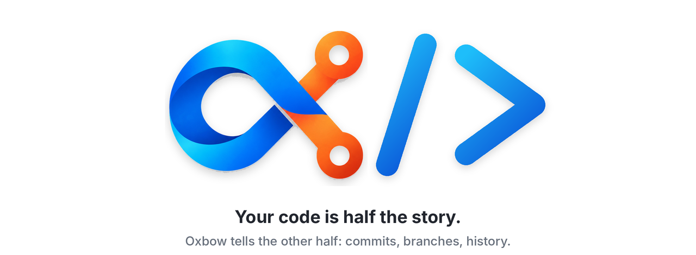
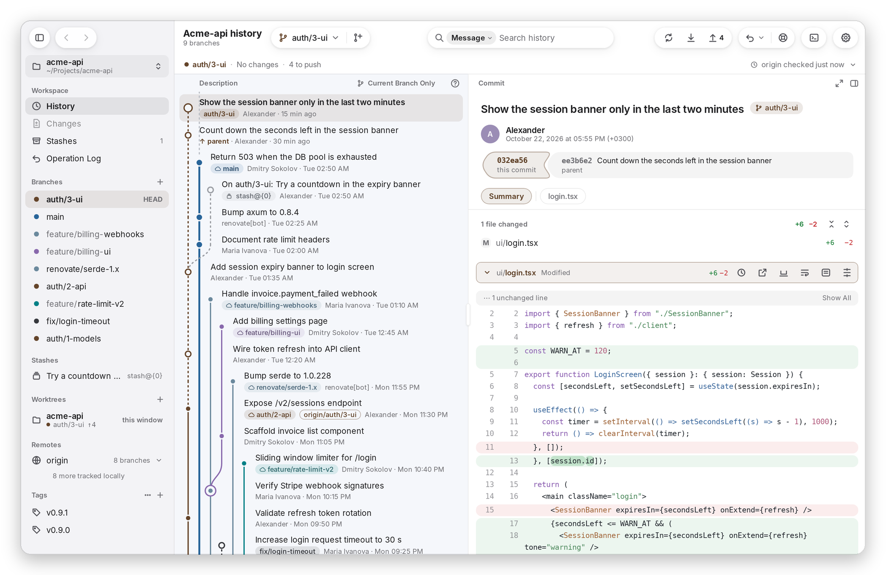
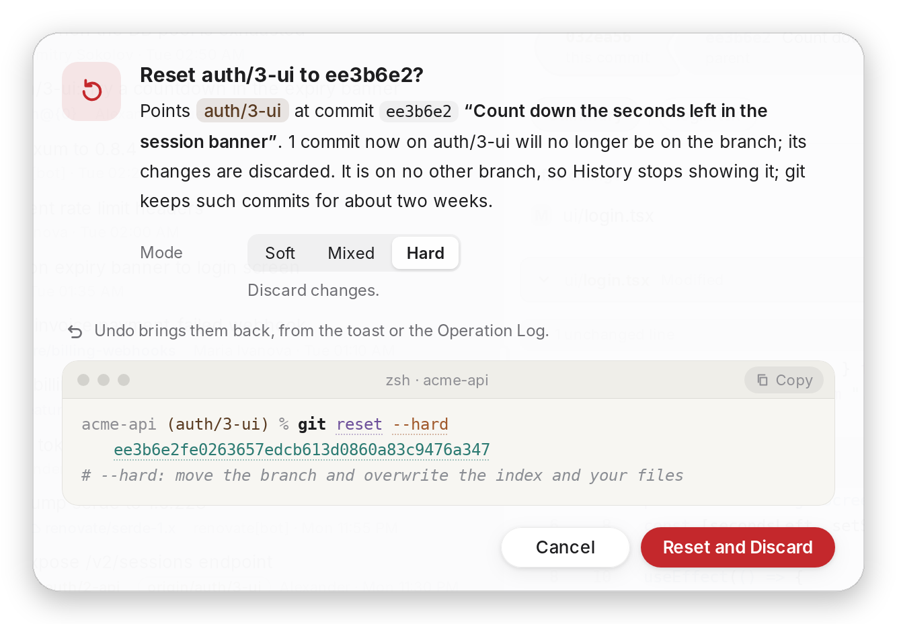
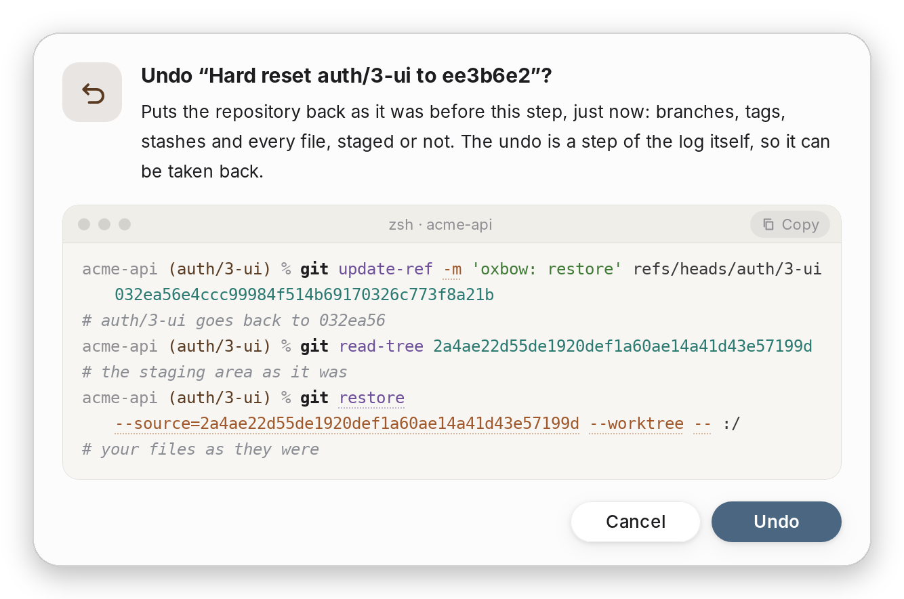

<p align="center">
  <picture>
    <source media="(prefers-color-scheme: dark)" srcset="docs/images/name-dark.png">
    
  </picture>
</p>

<p align="center">
  <picture>
    <source media="(prefers-color-scheme: dark)" srcset="docs/images/code-dark.png">
    
  </picture>
</p>

<p align="center">
  A desktop Git client that makes history clear and risky steps easier to understand.<br>
  Explore your work, see the Git commands before they run, and recover from supported mistakes.
</p>

<p align="center"><sub>Built for macOS first · In active development</sub></p>

<p align="center">
  <picture>
    <source media="(prefers-color-scheme: dark)" srcset="docs/images/history-dark.png">
    
  </picture>
</p>

<p align="center"><sub>Follow branches through the commit graph and inspect a change without leaving History.</sub></p>

## What Oxbow helps you do

**See how your work fits together.** Explore the commit graph, compare branches and commits,
search history and code, and inspect a file's history or blame. Staging works by file, hunk or
line; changelists let you commit separate pieces of work independently.

**Know what will happen.** Confirmations for risky actions explain the effect and show the exact
Git commands. Oxbow uses your system `git` for repository changes, including your hooks, SSH
and credential setup. The Console and Activity show what ran and what happened.

**Find a way back.** The Operation Log records supported local actions and can undo many of them,
including commits, rebases, merges, deleted branches, dropped stashes, hard resets and discards.
Lost Work finds commits in the reflog; Fix a Mistake helps choose a recovery path. Local History
captures eligible files saved while a repository is open, even when they were edited elsewhere.

**Keep a complex workflow in one place.** Work with stashes, worktrees, tags, submodules, Git LFS
and stacked branches. Review pull requests on GitHub and merge requests on GitLab, including
comments, suggestions and CI status. Run your own commands with live output and a Stop button.

## Recovery, with the details visible

<p align="center">
  <picture>
    <source media="(prefers-color-scheme: dark)" srcset="docs/images/confirm-dark.png">
    
  </picture>
</p>

<p align="center"><sub>Before a hard reset, Oxbow shows what will be discarded and the command it plans to run.</sub></p>

<p align="center">
  <picture>
    <source media="(prefers-color-scheme: dark)" srcset="docs/images/undo-dark.png">
    
  </picture>
</p>

<p align="center"><sub>For a supported action, Undo shows how the local repository will be restored.</sub></p>

Undo covers supported local actions, not remote changes or arbitrary custom scripts. Conflict
resolution cannot be undone as a conflict: snapshots do not preserve unmerged index stages,
operation metadata or Git's shared rerere cache. The Operation Log can still expose saved file
copies through **Compare with Now → Browse Saved Files → Save As**. Save a copy before replacing
current files. Undo and Restore are unavailable while a Git operation is in progress.

Dropped stashes and aborted operations keep a copy for 30 days. Local History keeps eligible
files up to 1 MB for seven days by default, with a 256 MB limit per worktree; its retention period
is configurable. It captures saves only while the repository is open.

## More in the app

- Merge, rebase, cherry-pick and revert with a three-way conflict editor
- Pull, push and fetch with explanations when a remote refuses an operation
- Stacked branch editing and restacking after a base branch is merged
- GitHub sign-in and repository publishing; GitLab connection with a personal access token
- A staged-line secrets check before commits, with custom patterns
- Repository trust controls, protected branches and configurable pre-commit checks
- Patch import and export, shared repository file editing, and a local recent-repositories view
- Command Palette, configurable keyboard shortcuts, and light and dark themes

## Project status

Oxbow is under active development. macOS is the primary build and testing target. Windows and
Linux release builds, Developer ID signing and macOS notarization are pending. GitLab integration
has automated tests against a test server; it has not yet been validated against a live GitLab
service.

CI checks pull requests on Linux. Pushes to `main` also build a macOS app and run Rust tests on
macOS. A macOS build artifact counts as checked only when every job in that run passes.

## Build from source

You need Rust stable (1.88 or newer), Node.js 22.12 or newer, a system `git` and the
[Tauri prerequisites](https://v2.tauri.app/start/prerequisites/) for your system.

```sh
cd app
npm ci
npm run tauri dev -- -- /path/to/repo   # omit the path to use the saved startup preference
```

From `app/`, run `npm run tauri build` to build the application bundle. From the repository root:

```sh
scripts/make-demo-repo.sh /tmp/oxbow-demo  # replaces this path with a demo repository
scripts/check.sh                            # checks changed app/core files
scripts/check.sh all                        # all formatting, lint, type and unit checks
```

## Architecture

- `crates/oxbow-core/` — UI-independent Rust library for Git operations
- `app/src-tauri/` — Tauri 2 desktop shell, native windows and system integration
- `app/src/` — Svelte 5 and TypeScript interface
- `app/tests/` and `app/e2e/` — frontend unit tests and application acceptance scenarios

History and diffs use [gitoxide](https://github.com/GitoxideLabs/gitoxide); repository changes
run the system Git CLI. Personal commands run only when invoked and show live output in a
resizable native window that remembers its size and position.

Third-party credits are in [THIRD-PARTY-NOTICES.txt](THIRD-PARTY-NOTICES.txt).
