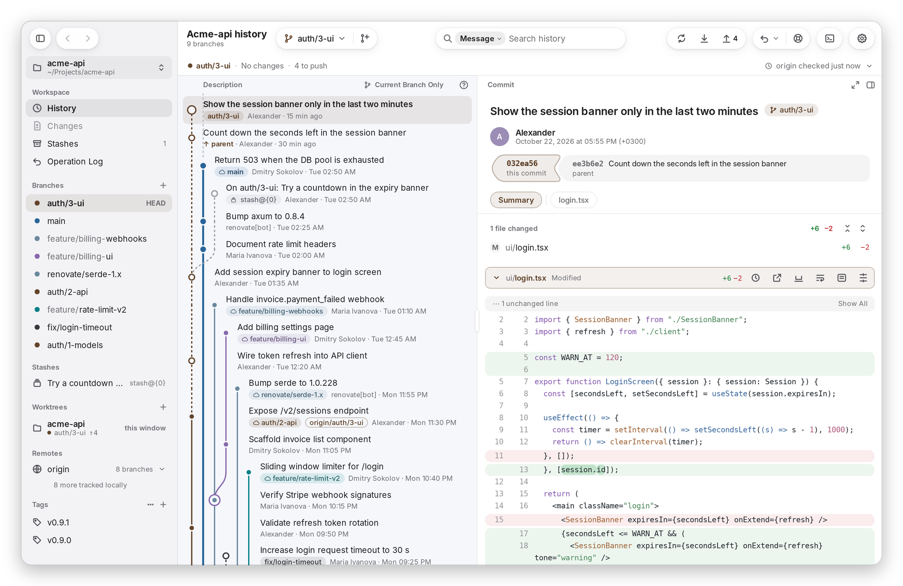
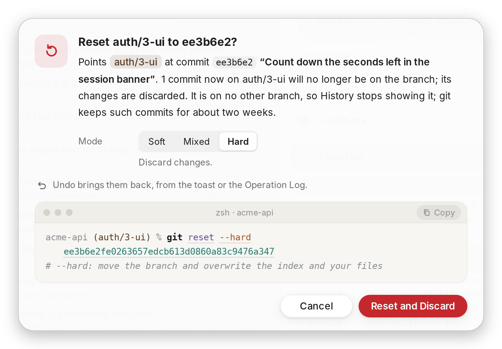
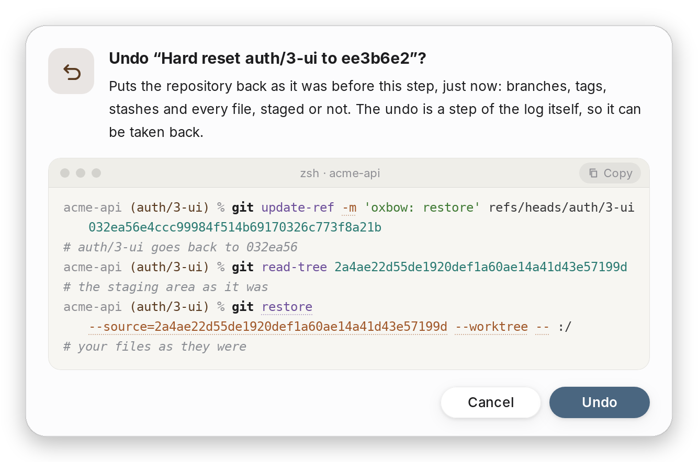

<p align="center">
  <picture>
    <source media="(prefers-color-scheme: dark)" srcset="docs/images/name-dark.png">
    
  </picture>
</p>

<p align="center">
  <picture>
    <source media="(prefers-color-scheme: dark)" srcset="docs/images/code-dark.png">
    
  </picture>
</p>

<p align="center">
  A calm, fast Git client that shows every git command before it runs<br>
  and can take back any step, even a hard reset.
</p>

<p align="center">
  <sub>For macOS. Windows and Linux are coming.</sub>
</p>

<p align="center">
  <picture>
    <source media="(prefers-color-scheme: dark)" srcset="docs/images/history-dark.png">
    
  </picture>
</p>

## Why Oxbow

**Undo any step.** Every change Oxbow makes goes into the Operation Log with the state of the
repository before and after it. ⌘Z (Ctrl+Z) takes back a commit, a rebase, a merge, a deleted branch, a
dropped stash, even a hard reset or discarded files. When a step holds something Undo can't bring
back, the confirmation says so before it runs.

**No surprises.** Before a change Oxbow shows the exact git commands it is going to run. Risky
ones ask first; simple ones run at once and show up in Activity, and the Console keeps the full
log.

**Real git underneath.** History, the graph and diffs are read with
[gitoxide](https://github.com/GitoxideLabs/gitoxide), so even big repositories open quickly.
Every change runs your own `git`, so hooks, credentials and SSH behave exactly as in a terminal.

**Nothing is lost.** Dropped stashes and aborted operations keep a copy for 30 days. Lost Work
finds commits from the reflog, and Fix a Mistake plans the way out of a commit on the wrong
branch, a forgotten file or a push you want to take back.

**Stacked branches.** Edit Stack rewrites a chain of branches in one go. Pull requests keep their
stack list up to date and the rest of a stack is restacked when its base is merged.

**Secrets stay out.** Before each commit the staged lines are checked for passwords, tokens and
private keys, with your own patterns on top.

<p align="center">
  <picture>
    <source media="(prefers-color-scheme: dark)" srcset="docs/images/confirm-dark.png">
    
  </picture>
  <picture>
    <source media="(prefers-color-scheme: dark)" srcset="docs/images/undo-dark.png">
    
  </picture>
</p>

## Everything you use every day

- Staging by file, hunk or line; changelists, each committed on its own; amend, reword, fixup
- Branches, tags, stashes, worktrees, submodules, Git LFS
- Merge, rebase, cherry-pick and revert with a three-way conflict editor
- Push, pull and fetch with clear messages when a remote refuses
- Compare branches and commits, search history and code, file history and blame
- Bisect, with a test command if you have one
- GitHub: sign in, publish a repository, open, review and merge pull requests
- Command Palette and VS Code's keyboard shortcuts, light and dark themes

## How it compares

|                   | Oxbow  | Fork     | Tower        | Sublime Merge | GitKraken             | GitHub Desktop |
| ----------------- | ------ | -------- | ------------ | ------------- | --------------------- | -------------- |
| macOS             | ✓      | ✓        | ✓            | ✓             | ✓                     | ✓              |
| Windows           | soon   | ✓        | ✓            | ✓             | ✓                     | ✓              |
| Linux             | soon   | –        | –            | ✓             | ✓                     | –              |
| Price             | Free   | Pay once | Subscription | Pay once      | Free for public repos | Free           |
| Undo for any step | ✓      | –        | ✓            | –             | Some steps            | Last commit    |

Based on each app's own site in October 2026.

## Building from source

You need Rust (stable), Node.js 22 or newer and the
[Tauri prerequisites](https://v2.tauri.app/start/prerequisites/) for your system.

```sh
cd app
npm ci
npm run tauri dev -- -- /path/to/repo   # or without a path: the last repository
```

`scripts/make-demo-repo.sh /tmp/acme-api` makes a small repository with branches, merges, tags and
unpushed work to try it on. `scripts/check.sh` runs formatting, lints and tests, and
`npm run tauri build` makes an installable app. How Oxbow is put together is in
[docs/architecture.md](docs/architecture.md).

Third-party credits are in [THIRD-PARTY-NOTICES.md](THIRD-PARTY-NOTICES.md).
